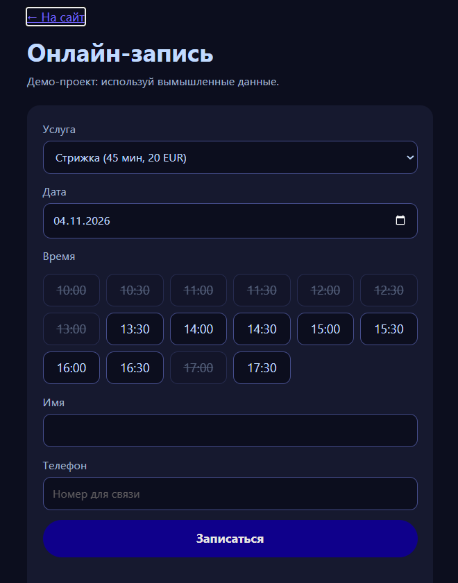
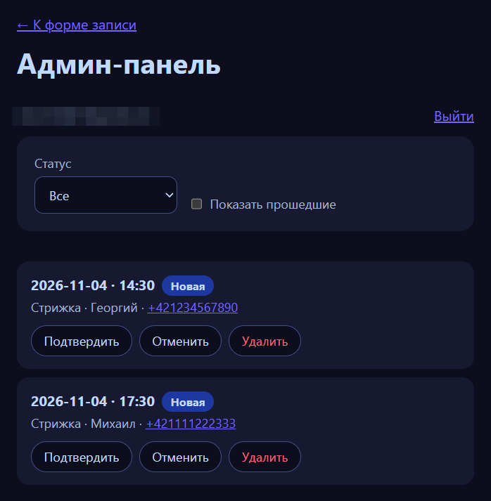

# Онлайн-запись клиентов

Демо-проект: форма записи, база данных и админ-панель с входом.

**Демо:** https://fuzzyrobotyt.github.io/booking/index.html

## Что умеет
- Клиент выбирает услугу, дату и свободное время и оставляет имя и телефон
- Занятое время блокируется, двойная запись невозможна (уникальный индекс в базе)
- Админ-панель (`admin.html`) с входом по почте и паролю: просмотр заявок, подтверждение, отмена, удаление, фильтры по статусу и дате

## Технологии
HTML, CSS, JavaScript, Supabase (PostgreSQL и Auth), GitHub Pages

## Как устроена база данных
- `services`: услуги (название, длительность, цена)
- `bookings`: заявки (услуга, имя, телефон, дата, время, статус)
- частичный уникальный индекс по дате и времени для неотменённых заявок
- функция `taken_slots(day)` возвращает занятые времена без персональных данных клиентов

## Как устроена защита
- Включена защита строк (Row Level Security) на обеих таблицах
- Гость может только читать список услуг и создавать заявку со статусом `new`
- Читать, менять и удалять заявки может только администратор (проверка по почте), регистрация новых пользователей закрыта
- Ограничения дублируются в базе: даты в пределах 60 дней, время с 10:00 до 17:30 с шагом 30 минут, длина полей
- В коде страницы используется только публичный (publishable) ключ, секретный ключ нигде не хранится
- Спам-ловушка: скрытое поле формы

## Как запустить у себя
1. Создать проект в Supabase и таблицы `services` и `bookings`, включить RLS и создать политики по описанию выше
2. Создать пользователя-админа и отключить регистрацию
3. Вписать адрес проекта и публичный ключ в `app.js` и `admin.js`
4. Открыть `index.html` через Live Server

## Чему я научился
(отредактируй под себя)
- Как работают политики RLS и почему проверки нужно дублировать в базе
- Как подключить сайт к Supabase и обрабатывать ошибки запросов
- Как устроена авторизация по почте и паролю

## Ограничения
Проект учебный: данные вымышленные, защита от целенаправленного спама ограничена. Бесплатный проект Supabase засыпает после недели без активности.

> Проект сделан с помощью ИИ-ассистента (Claude). Я разобрал код, проверил его работу и безопасность.
