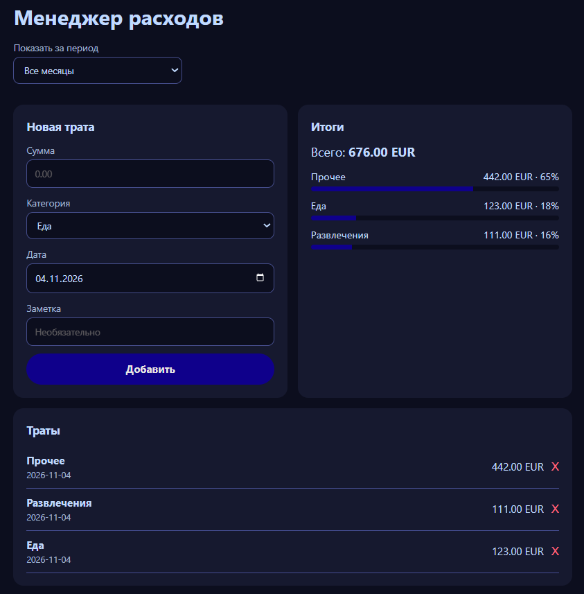

# Менеджер расходов

Приложение для учёта личных трат.

**Демо:** https://fuzzyrobotyt.github.io/expenses/index.html

## Что умеет
- Добавлять и удалять траты (сумма, категория, дата, заметка)
- Показывать общий итог и итоги по категориям с долей в процентах
- Фильтровать траты по месяцам
- Сохранять данные между визитами

## Технологии
HTML, CSS, JavaScript (без библиотек)

## Как это устроено
- Данные хранятся в `localStorage` браузера (ключ с версией формата), чтение защищено `try/catch`
- Список перерисовывается функцией `render()` из массива данных
- Пользовательский текст выводится через `textContent`, а не `innerHTML` (защита от внедрения кода)
- Кнопки удаления обрабатываются одним обработчиком (делегирование событий)

## Ограничения
Данные лежат только в браузере: на другом устройстве их не будет. Для хранения на сервере я использовал базу данных в проекте [онлайн-записи](../booking).

## Чему я научился
- Работа с DOM и событиями формы
- Массивы, объекты, `filter`, `reduce`, `sort`
- Сохранение данных в `localStorage` и разбор ошибок по консоли браузера

> Проект сделан с помощью ИИ-ассистента (Claude). Я набирал и отлаживал код сам, исправляя опечатки и ошибки по сообщениям консоли.
