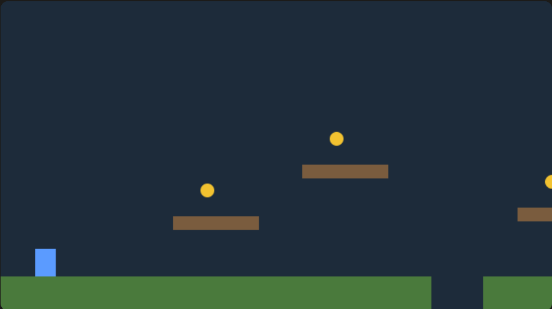
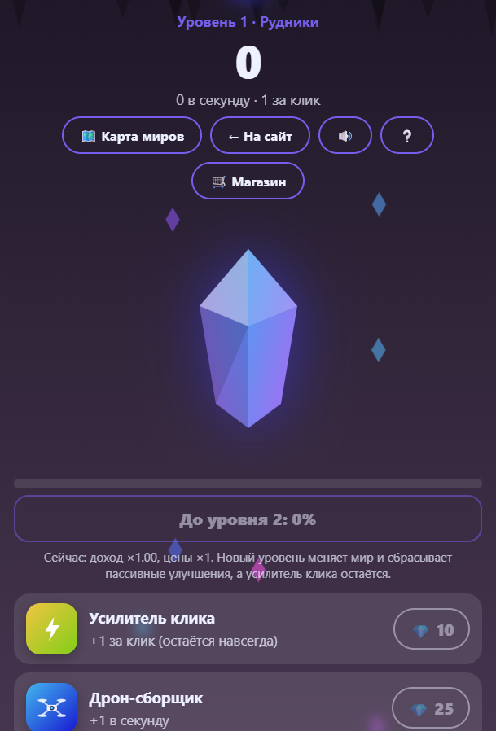

# Игры

Две браузерные игры, которые работают прямо в браузере без установки.

## Платформер
**Играть:** https://fuzzyrobotyt.github.io/games/platformer.html

- Управление: стрелки или A/D и пробел или W, на телефоне есть кнопки
- Прыжки, физика, столкновения, монеты, патрулирующие враги, камера, победа
- Технологии: HTML, CSS, JavaScript, Canvas

## Кликер «Кристаллы»
**Играть:** https://fuzzyrobotyt.github.io/games/clicker.html

- Четыре мира с разной темой (рудники, лес, океан, космос), которые открываются повышением уровня
- Улучшения, достижения с индивидуальными бонусами, бонусы, пролетающие по экрану, карта миров
- Звуки синтезируются в браузере (Web Audio), графика нарисована в SVG, прогресс сохраняется
- **Реклама и магазин в игре тестовые:** это имитация для проверки логики, реальных платежей и рекламы нет
- Технологии: HTML, CSS, JavaScript, SVG, Web Audio

## Чему я научился
- Игровой цикл, анимации и работа с вводом
- Сохранение прогресса и расчёт дохода по времени
- Как продумывается баланс и экономика игры

> Игры сделаны с помощью ИИ-ассистента (Claude) в учебных целях.
